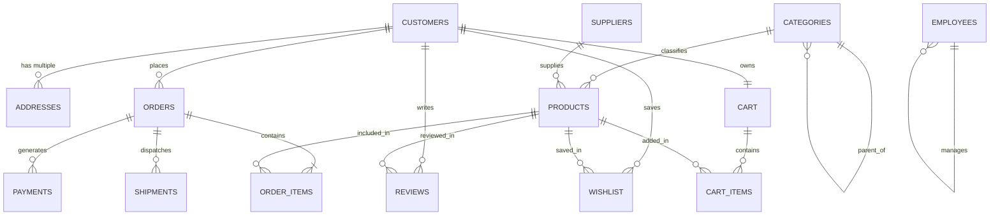

# 🛒 E-Commerce Management System — Advanced SQL Solutions

A comprehensive, production-grade SQL repository solving **110 advanced relational queries** across an enterprise **E-Commerce Management System**. Designed for database architects, software engineers, and data analysts preparing for high-bar technical interviews (FAANG / Tier-1 Tech).

---

## 🏛️ Database Schema & Architecture

The database models a multi-vendor e-commerce platform with 14 normalized tables, enforcing referential integrity, self-referencing category and management hierarchies, complex transaction states, and shopping cart persistence.

---

## 📂 Repository File Index

All 110 queries are grouped into their corresponding standalone SQL scripts:

| # | File Name | Question Range | Topics & Techniques Covered |
|---|---|:---:|---|
| 01 | [`create_tables.sql`](create_tables.sql) | DDL | Complete 14-table schema with PKs, FKs, `CHECK`, and `UNIQUE` constraints |
| 02 | [`seed_data.sql`](seed_data.sql) | DML | Comprehensive test dataset covering all edge cases (nulls, orphans, hierarchies) |
| 03 | [`Basic_Queries.sql`](Basic_Queries.sql) | Q1 – Q10 | `SELECT`, `WHERE`, `ORDER BY`, `LIMIT`, Date/Time intervals |
| 04 | [`aggregate_functions.sql`](aggregate_functions.sql) | Q11 – Q20 | `COUNT`, `SUM`, `AVG`, `MIN`, `MAX`, `COALESCE`, `ROUND` |
| 05 | [`group_by.sql`](group_by.sql) | Q21 – Q30 | Multi-level grouping, monthly date formatting (`TO_CHAR`), city counts |
| 06 | [`having.sql`](having.sql) | Q31 – Q35 | Post-aggregation threshold filtering on groups (`HAVING COUNT > 20`) |
| 07 | [`inner_joins.sql`](inner_joins.sql) | Q36 – Q45 | Multi-table joins across 3+ tables resolving Many-to-Many junctions |
| 08 | [`left_joins.sql`](left_joins.sql) | Q46 – Q50 | Anti-Join patterns (`WHERE right.pk IS NULL`) finding dormant users & unsold stock |
| 09 | [`right_full_joins.sql`](right_full_joins.sql) | Q51 – Q55 | `FULL OUTER JOIN` & `RIGHT JOIN` preserving unmatched domain sets |
| 10 | [`sub_queries.sql`](sub_queries.sql) | Q56 – Q65 | Scalar subqueries, derived tables, `OFFSET`, and Relational Division |
| 11 | [`correlated_subqueries.sql`](correlated_subqueries.sql) | Q66 – Q70 | Row-by-row comparisons against contextual category/city benchmarks |
| 12 | [`window_functions.sql`](window_functions.sql) | Q71 – Q80 | `DENSE_RANK()`, `ROW_NUMBER() OVER (PARTITION BY)`, Running Totals, Moving Frames |
| 13 | [`CTE.sql`](CTE.sql) | Q81 – Q85 | Modular Common Table Expressions (`WITH ... AS`) for RFM & VIP tiers |
| 14 | [`recursive_CTE.sql`](recursive_CTE.sql) | Q86 – Q90 | Graph & tree traversal: Breadcrumb paths, ASCII trees, and employee reporting lines |
| 15 | [`transaction.sql`](transaction.sql) | Q91 – Q95 | ACID controls, `SAVEPOINT`, `ROLLBACK`, `COMMIT`, Pessimistic locking (`FOR UPDATE`) |
| 16 | [`optimisation.sql`](optimisation.sql) | Q96 – Q100 | B-Tree indexing, `EXPLAIN ANALYZE` profiling, Sequential vs. Index Scan cost reduction |
| 17 | [`Mega_Challenge_Queries.sql`](Mega_Challenge_Queries.sql) | Q101 – Q110 | Amazon Sales BI Dashboard, CLV, Market Basket Affinity, MoM Growth %, Moving Averages |

---

## 🎯 Questions Solved (1 – 110)

<b>Click to expand full 110 question checklist</b>

- [x] **Basic Queries (1–10):** All customers, products > ₹5000, low stock < 10, all suppliers, completed orders, current month orders, 30-day signups, price sort DESC, top 10 expensive, active shipments.
- [x] **Aggregate Functions (11–20):** Total customers, total products, average price, highest/lowest priced products, gross GMV, order counts, warehouse stock sum, AOV, collected payments.
- [x] **GROUP BY (21–30):** Category product count, category sales, supplier revenue, city customer distribution, order status breakdown, product ratings, shipment status count, payment method share, monthly sales trends.
- [x] **HAVING Clause (31–35):** Categories with > 20 products, suppliers > 10 products, customers > 5 orders, products rated > 4.0, cities > 50 customers.
- [x] **INNER JOINS (36–45):** Customer order details, order product items, product category titles, product suppliers, reviews with customer names, payment records with customer details, shipments with orders, cart items, wishlists, and addresses.
- [x] **LEFT JOINS (46–50):** Customers without orders, products never ordered, unreviewed products, customers without addresses, unpaid orders.
- [x] **RIGHT/FULL JOINS (51–55):** Products & reviews full outer join, customers & orders, suppliers & products, categories & products, orders & shipments.
- [x] **Subqueries (56–65):** Top 1st, 2nd, and 3rd selling products, highest spenders, customers spending above average, products above average price, top supplier, top category, relational division, unpurchased items.
- [x] **Correlated Subqueries (66–70):** Products costing above their category average, customers spending above their city average, suppliers with revenue above average, orders larger than customer's average, products above average reviews.
- [x] **Window Functions (71–80):** DENSE_RANK for products, customers, suppliers; top 3 products per category, top 5 customers per city, running total revenue, cumulative monthly sales, highest order per customer, latest order per customer, top-rated product per category.
- [x] **CTE Queries (81–85):** Category revenue via CTE, customer spending summary with VIP tiers, top 10 customers via CTE, top products via CTE, supplier performance reports.
- [x] **Recursive CTE (86–90):** Category breadcrumb hierarchy, sub-category tree view with indentation, employee reporting hierarchy, manager transitive spans, category depth levels.
- [x] **Transaction Questions (91–95):** Order + payment + shipment inside single TX, rollback on failed payment, SAVEPOINT checkout recovery, COMMIT durability, concurrency-safe inventory deduction (`FOR UPDATE`).
- [x] **Optimization (96–100):** Indexes on product name and email, before/after EXPLAIN ANALYZE comparison, revenue query plan profiling, highest-selling product rewrite.
- [x] **Mega Challenges (101–110):** Amazon-style Sales Dashboard, Top 10 Products Report, Customer Lifetime Value (CLV), Frequently Bought Together cross-sell, Repeat Customer Interval Analysis (`LAG`), Inventory Aging Buckets, Supplier BI Scorecard, MoM Growth Rates, Revenue Forecast Models, Complete Executive KPI Dashboard.

 
